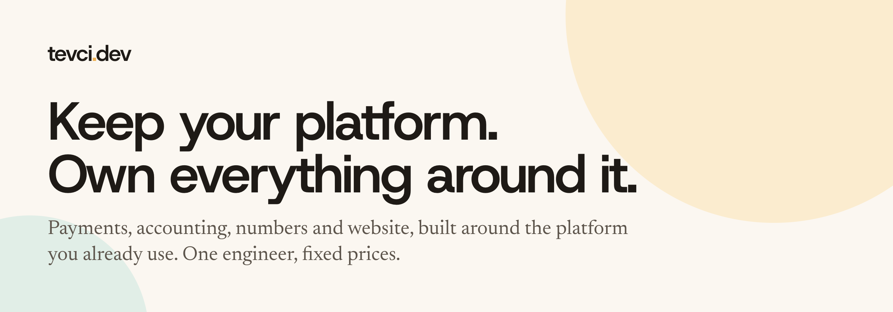

I'm Tim, one engineer, not an agency. Since 2021 I have been the developer behind [ArjanCodes](https://arjancodes.com): payments, accounting, numbers, website and team sales, built around the course platform it already uses.

I now do the same for other small businesses that sell through a platform. The platform stays. The four pieces around it become yours.

- **Payments** in your name, with local prices and the ways your buyers expect to pay
- **Accounting** that matches every sale, refund and fee into your books automatically
- **Numbers** from every channel in one dashboard, every morning
- **Website** that is yours to change, with the platform kept as the product

See it live: [arjancodes.com](https://arjancodes.com) and [business.arjancodes.com](https://business.arjancodes.com).

[tevci.dev](https://tevci.dev) · [Book a 20 minute call](https://calendar.app.google/sBzhVH7v9A6HTyHF7) · [LinkedIn](https://www.linkedin.com/in/timurcan-evci) · [tim@tevci.dev](mailto:tim@tevci.dev)
